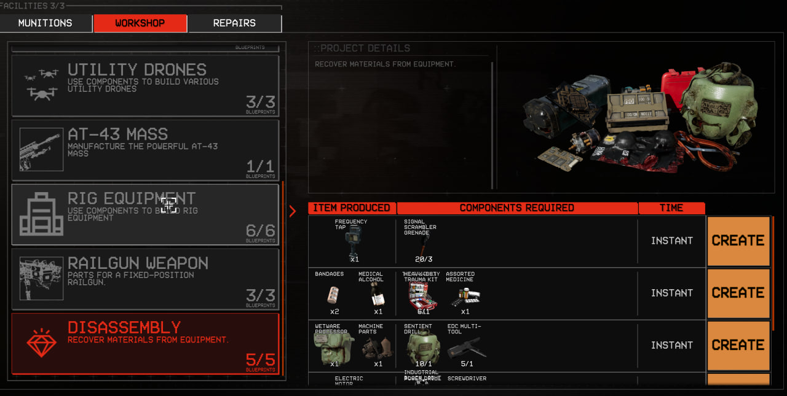

# More Crafting Recipes

Adds crafting and disassembly recipes to the Innards workshop. Use spare loot to make tools, electronics, rig boxes, and supplies with less farming for specific drops.

## Requirements

**The Forever Winter for Windows (64-bit)** and **RE-UE4SS 4.0.0 Experimental**, tested with commit `b2d936b9`. [UE4SS downloads](https://github.com/UE4SS-RE/RE-UE4SS/releases) · [Installation guide](https://docs.ue4ss.com/dev/installation-guide.html)

## Install

1. Close the game and install UE4SS.
2. Extract the release ZIP into `The Forever Winter\Windows\ForeverWinter\Binaries\Win64` so the `ue4ss` folders merge.
3. Verify that `Win64\ue4ss\Mods\MoreCraftingRecipes` contains `enabled.txt`, `MoreCraftingRecipes.ini`, and `Scripts\main.lua`.
4. Launch the game and visit Bunco or Manufacturing in the Innards.

Collect pending custom crafts before updating or uninstalling. To update, back
up `MoreCraftingRecipes.ini` and `manuals.ini`, replace the mod folder, and copy
back your settings and progress. To uninstall, close the game and remove
`ue4ss\Mods\MoreCraftingRecipes`.

## Settings and manuals

Close the game before editing `MoreCraftingRecipes.ini`.

- `[Crafting] Instant` is enabled in the supplied INI and applies to new stock and custom Manufacturing jobs. Set it to `false` to use the game's craft times.
- Recipe manuals are optional and enabled by default. Buy them in **Bunco → Consumables** to unlock recipe groups, in any tier order. Set `Enabled = false` under `[RecipeBooks]` to skip manual requirements.
- `[RecipeBookPrices]` controls manual prices. Enter whole credit amounts without commas. Tier prices start at 100,000 CR and rise to 600,000 CR. The IFF and Provisions manuals cost 100,000 CR each.

Custom recipes keep the stock template's facility and blueprint requirements.
Manual unlocks are saved in `manuals.ini` beside the settings file.

## Where to find recipes

- **Munitions → Disassembly**. Recover materials from standard and specialist ammunition.
- **Workshop → Refinery**. Process materials and make thermite and explosive charges.
- **Workshop → Tools & Kits**. Make and upgrade tools and repair kits.
- **Workshop → Fabrication**. Build mechanical assemblies and industrial equipment.
- **Workshop → Power & Lighting**. Make batteries, chargers, power cells, and lights.
- **Workshop → Electronics & Comms**. Build computers, radios, and field electronics.
- **Workshop → Disassembly**. Recover materials and components from spare equipment.
- **Workshop → Rig Boxes**. Craft storage boxes and upgrade matching spare boxes.
- **Workshop → U.I.D.**. Craft eligible Level 1 IFFs and downgrade chips within the same faction.
- **Workshop → Provisions**. Blend alcohol and upgrade cigarettes.

## Compatibility

Tested alongside NoTimeGating. For another timing mod to control craft times, set `Instant = false`.

## Recipe reference

† Skipped if the item already has a stock recipe.

### Munitions → Disassembly

| Inputs | Outputs | Manual |
| --- | --- | --- |
| 60 12-Gauge Buckshot | 2 Ball Bearings + 1 Fertilizer | Munitions Manual A |
| 180 .308 | 2 Nails + 1 Gunpowder | Munitions Manual A |
| 120 .357 Magnum | 2 Nails + 1 Gunpowder | Munitions Manual A |
| 180 .45 ACP | 2 Metal Fragments + 1 Gunpowder | Munitions Manual A |
| 180 5.45x39mm | 2 Metal Fragments + 1 Gunpowder | Munitions Manual A |
| 180 5.56x45mm | 2 Metal Fragments + 1 Gunpowder | Munitions Manual A |
| 180 5.7x28mm | 2 Metal Fragments + 1 Gunpowder | Munitions Manual A |
| 180 7.62x39mm | 2 Nails + 2 Gunpowder | Munitions Manual A |
| 240 9x19mm | 2 Metal Fragments + 1 Fertilizer | Munitions Manual A |
| 16 .50 PST | 8 .50 BMG + 4 Thermite + 1 Diodegradable Multi-tool | Munitions Manual B |
| 60 12.7x55mm Subsonic | 1 Rare Metals + 2 Gunpowder | Munitions Manual B |
| 20 20x105mm Anti-Tank | 2 Rare Metals + 1 Explosives | Munitions Manual B |
| 60 .50 BMG | 2 Rare Metals + 2 Gunpowder | Munitions Manual B |
| 60 7.62x54mmR | 1 Rare Metals + 2 Gunpowder | Munitions Manual B |
| 60 5.45x39mm Cryo | 30 5.45x39mm + 3 Dogboro Cigarettes | Munitions Manual B |
| 60 5.45x39mm Cryo | 30 5.45x39mm + 1 Whiskey | Munitions Manual B |

### Workshop → Refinery

| Inputs | Outputs | Manual |
| --- | --- | --- |
| 3 Matches + 2 Thermal Matches + 2 Gunpowder | 1 Thermite | Munitions Manual B |
| 2 Explosives + 1 Printed Circuit Board + 1 Battery | 1 Explosive Charge | Munitions Manual B |
| 1 Hose + 1 Duct Tape + 1 Industrial Sealant | 1 Ribbed Tube | Workshop Manual A |
| 2 Metal Slats + 1 Nails | 1 Sheet Metal | Workshop Manual A |
| 3 Carbon Fiber + 1 Printing Resin | 1 Carbon Fiber Tube | Workshop Manual C |
| 1 Industrial Chemicals + 1 Pressure Gauge + 1 Construction Glue + 1 Industrial Sealant | 1 Construction Foam | Workshop Manual C † |
| 2 Drywall + 2 Metal Fragments + 1 Urea + 1 Industrial Chemicals | 1 Concrete Powder | Workshop Manual C † |

### Workshop → Tools & Kits

| Inputs | Outputs | Manual |
| --- | --- | --- |
| 1 Hammer + 1 Screwdriver + 1 Basic Pliers | 1 Scavenger's Tool Kit | Workshop Manual A |
| 1 Scavenger's Tool Kit + 1 Hand Drill + 1 Pipe Wrench | 1 Old Tool Set | Workshop Manual A |
| 2 Metal Fragments + 1 Cordura + 1 Fleece + 1 Leather Hole Punch | 1 Sewing Kit | Workshop Manual A † |
| 1 Old Tool Set + 1 Advanced Pliers + 1 Ratchet | 1 Intermediate Tool Set | Workshop Manual B |
| 1 Hand Drill + 1 Machine Parts + 1 Wires + 1 Rechargeable Battery | 1 Power Drill | Workshop Manual B † |
| 1 Fire Starter Kit + 1 Power Supply Unit + 2 Glue + 1 Super Glue | 1 Glue Gun | Workshop Manual B † |
| 1 Old Tool Set + 1 Military Tape + 1 Weapon Parts + 1 Military Grade Lubricant | 1 Field Repair Kit | Workshop Manual B † |
| 1 Basic Pliers + 2 Metal Pipe + 2 Bolts + 1 Advanced Pliers | 1 Bolt Cutters | Workshop Manual B † |
| 1 Hammer + 1 Metal Pipe + 2 Metal Fragments + 1 Construction Glue | 1 Sledgehammer | Workshop Manual B † |
| 1 Pipe Wrench + 1 Ratchet + 1 Weapon Parts + 1 Grindstone | 1 Armorer's Wrench | Workshop Manual B † |
| 1 Intermediate Tool Set + 1 EDC Multi-tool + 1 Measuring Tape | 1 Precision Tool Set | Workshop Manual C |
| 1 Power Drill + 1 Machine Parts + 1 Electric Motor | 1 Rotary Hammer | Workshop Manual C † |
| 1 Bolt Cutters + 1 Grindstone + 1 Carbon Fiber + 1 Construction Foam | 1 Anti-Vertex Bolt Cutters | Workshop Manual D † |
| 1 Field Repair Kit + 1 Armorer's Wrench + 2 Advanced Joint + 1 Construction Foam | 1 Exo Repair Kit | Workshop Manual D † |

### Workshop → Fabrication

| Inputs | Outputs | Manual |
| --- | --- | --- |
| 1 Machine Parts + 2 Wires + 2 Ball Bearings + 1 Industrial Sealant | 1 Electric Motor | Workshop Manual B † |
| 1 Electric Motor + 2 Machine Parts + 2 Spark Plug + 1 Power Supply Unit | 1 Portable Generator | Workshop Manual C |
| 2 Ball Bearings + 1 Electric Motor + 1 Machine Parts | 1 Advanced Joint | Workshop Manual C |
| 2 Sheet Metal + 1 Electric Motor + 1 Relay + 1 Wires | 1 Turret Component | Workshop Manual C |
| 2 Ball Bearings + 2 Bolts + 1 Metal Pipe + 1 Military Grade Lubricant | 1 Heavy Joint Assembly | Workshop Manual C † |
| 1 GP-5 Gas Mask + 1 Sheet Metal + 1 Fleece + 1 Carbon Fiber | 1 Ventilation Filter | Workshop Manual C † |
| 1 Metal Pipe + 2 Sheet Metal + 1 Electric Motor + 1 Concrete Powder | 1 Concrete Mixer | Workshop Manual C † |
| 1 Ventilation Filter + 1 Pressure Gauge + 1 Telemetry Unit + 1 Construction Foam | 1 Ventilation Regulator | Workshop Manual D † |
| 2 Thermite + 2 Metal Fragments + 1 Pressure Gauge + 1 Construction Foam | 1 Crucible | Workshop Manual D † |
| 2 Liquid Cooling Unit + 1 Ribbed Tube + 1 Carbon Fiber Tube + 1 Liquid Coolant | 1 Railgun Cooling Component | Workshop Manual D † |

### Workshop → Power & Lighting

| Inputs | Outputs | Manual |
| --- | --- | --- |
| 2 Battery + 1 Wires | 1 Rechargeable Battery | Electronics Manual A |
| 1 Clear Tube + 1 Wires | 1 Light Bulb | Electronics Manual A |
| 2 Light Bulb | 1 Light Bulbs | Electronics Manual A |
| 1 Light Bulb + 1 Printed Circuit Board | 1 ES Lamp | Electronics Manual A |
| 1 Power Supply Unit + 1 Jumper Cable Kit + 1 Relay + 1 LCD | 1 Battery Charger | Electronics Manual A † |
| 4 Battery + 1 Jumper Cable Kit + 1 Industrial Chemicals | 1 Car Battery | Electronics Manual A † |
| 1 ES Lamp + 1 Camera Lens | 1 UV Light Bulb | Electronics Manual B |
| 2 ES Lamp + 2 Sheet Metal + 1 Relay | 1 Bulkhead Lights | Electronics Manual B |
| 1 Car Battery + 1 Military Cables + 1 Military Tape + 1 Industrial Sealant | 1 Military Battery | Electronics Manual C † |
| 1 Power Cell + 1 Military Cables + 1 Military Circuitry | 1 Military Power Cell | Electronics Manual C † |
| 2 UV Light Bulb + 1 Sheet Metal + 1 Power Cell + 1 Relay | 1 Industrial Black Light | Electronics Manual C † |
| 2 Car Battery + 1 LCD + 1 Power Cell + 1 Industrial Sealant | 1 Solar Battery | Electronics Manual C † |

### Workshop → Electronics & Comms

| Inputs | Outputs | Manual |
| --- | --- | --- |
| 1 Diodegradable Multi-tool + 1 Battery + 1 Printed Circuit Board | 1 EDC Multi-tool | Electronics Manual B |
| 2 Europa MilTech Radio + 1 Printed Circuit Board | 1 Multi-frequency Broadcaster | Electronics Manual B |
| 1 Computer Fan + 1 Ribbed Tube + 1 Pressure Gauge + 1 Liquid Coolant | 1 Liquid Cooling Unit | Electronics Manual B † |
| 2 Printed Circuit Board + 1 Wires + 1 CPU + 1 Processor Board | 1 Motherboard | Electronics Manual B † |
| 2 Hard Drive + 1 Mini MD Drive + 1 Processor Board | 1 High Capacity Hard Drive | Electronics Manual B † |
| 1 Analog Headset + 1 Military Cables + 1 Modem + 1 Power Cell | 1 High-Frequency Radio | Electronics Manual B † |
| 2 High Capacity Hard Drive + 1 Military Circuitry | 1 Military Hard Drive | Electronics Manual C |
| 1 High Capacity Hard Drive + 2 Printed Circuit Board + 1 Rechargeable Battery + 1 Industrial Sealant | 1 Hard Shell Laptop | Electronics Manual C |
| 1 Hard Drive + 1 Military Tape + 1 LCD + 1 Processor Board | 1 Military PDA | Electronics Manual C † |
| 1 High Capacity Hard Drive + 1 Processor Board + 1 Organoid Plug + 1 Organoid Outlet | 1 Organoid Memory Board | Electronics Manual C † |
| 1 High-Frequency Radio + 1 Scavenger's Go-Bag + 1 Military Battery | 1 Manpack Radio | Electronics Manual C † |
| 1 Camera + 1 Camera Lens + 1 Military PDA + 1 OLED | 1 Laser Rangefinder | Electronics Manual C † |
| 1 Field Repair Kit + 1 Computer Fan + 1 Electric Motor + 1 Military Power Cell | 1 Repair Dronelet | Electronics Manual C † |
| 2 High Capacity Hard Drive + 1 Liquid Cooling Unit + 1 Organoid Memory Board | 1 Quantum Hard Drive | Electronics Manual D † |
| 1 Organoid Networking Board + 1 Liquid Cooling Unit + 1 Organoid Plug + 1 Organoid Outlet | 1 Wetware Processor | Electronics Manual D † |
| 1 Military PDA + 1 OLED + 1 Military Circuitry + 1 Quantum Hard Drive | 1 Encrypted Data Pad | Electronics Manual D † |
| 1 Encrypted Data Pad + 1 Frequency Tap + 1 Neuro Uplink Board | 1 Rootkit Device | Electronics Manual D † |

### Workshop → Disassembly

| Inputs | Outputs | Manual |
| --- | --- | --- |
| 3 Signal Scrambler Grenade | 1 Frequency Tap | Electronics Manual B |
| 1 Industrial Black Light | 1 UV Light Bulb + 2 Wires + 1 Relay | Electronics Manual B |
| 1 Heavy-Duty Trauma Kit | 2 Bandages + 1 Medical Alcohol + 1 Tourniquet + 1 Assorted Medicine | Workshop Manual A |
| 1 Power Drill + 1 Screwdriver | 1 Electric Motor | Workshop Manual B |
| 1 Sentient Drill + 1 EDC Multi-tool | 1 Wetware Processor + 1 Machine Parts | Workshop Manual D |

Salvage consumes the listed tools.

### Workshop → Rig Boxes

Choose the size and position that fit your rig. Keep the matching spare low-quality box in the stash before upgrading.

| Inputs | Outputs | Manual |
| --- | --- | --- |
| 1 Metal Slats + 1 Screws | 1 Small low-quality box | Rig Storage Manual A |
| 2 Metal Slats + 1 Screws | 1 Medium low-quality box | Rig Storage Manual A |
| 3 Metal Slats + 2 Screws | 1 Large low-quality box | Rig Storage Manual A |
| 1 Matching small low-quality box + 1 Sheet Metal + 1 Duct Tape | 1 Small high-quality box | Rig Storage Manual B |
| 1 Matching medium low-quality box + 2 Sheet Metal + 1 Duct Tape | 1 Medium high-quality box | Rig Storage Manual B |
| 1 Matching large low-quality box + 2 Sheet Metal + 1 Sewing Kit + 1 Carbon Fiber Tube | 1 Large high-quality box | Rig Storage Manual C |

### Workshop → U.I.D.

| Inputs | Outputs | Manual |
| --- | --- | --- |
| 1 Eurasian IFF Chip LVL3 | 2 Eurasian IFF Chip LVL2 | IFF Manual |
| 1 Eurasian IFF Chip LVL2 | 2 Eurasian IFF Chip LVL1 | IFF Manual |
| 1 Europan IFF Chip LVL3 | 2 Europan IFF Chip LVL2 | IFF Manual |
| 1 Europan IFF Chip LVL2 | 2 Europan IFF Chip LVL1 | IFF Manual |
| 1 Euruskan IFF Chip LVL3 | 2 Euruskan IFF Chip LVL2 | IFF Manual |
| 1 Euruskan IFF Chip LVL2 | 2 Euruskan IFF Chip LVL1 | IFF Manual |
| 1 Printed Circuit Board + 1 Frequency Tap + 1 Modem | 1 Eurasian IFF Chip LVL1 | IFF Manual † |
| 1 Printed Circuit Board + 1 Frequency Tap + 1 Modem | 1 Europan IFF Chip LVL1 | IFF Manual † |
| 1 Printed Circuit Board + 1 Frequency Tap + 1 Modem | 1 Euruskan IFF Chip LVL1 | IFF Manual † |

### Workshop → Provisions

| Inputs | Outputs | Manual |
| --- | --- | --- |
| 2 Gin + 2 Vodka | 1 Whiskey | Provisions Manual |
| 3 Wine | 1 Brandy | Provisions Manual |
| 2 Whiskey | 1 Scotch | Provisions Manual |
| 1 Brandy + 1 Whiskey + 2 Wine | 1 Prized Alcohol | Provisions Manual |
| 2 Dogboro Cigarettes + 1 Deep Fried Coffee | 1 Hinoko Cigarettes | Provisions Manual |
| 1 Hinoko Cigarettes + 3 Dogboro Cigarettes | 1 Nucky Gold Cigarettes | Provisions Manual |

## Screenshots and developer tools

[Screenshot gallery](assets/screenshots/) · [Developer guide](DEVELOPMENT.md)
