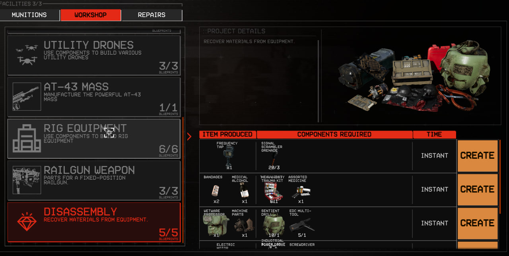
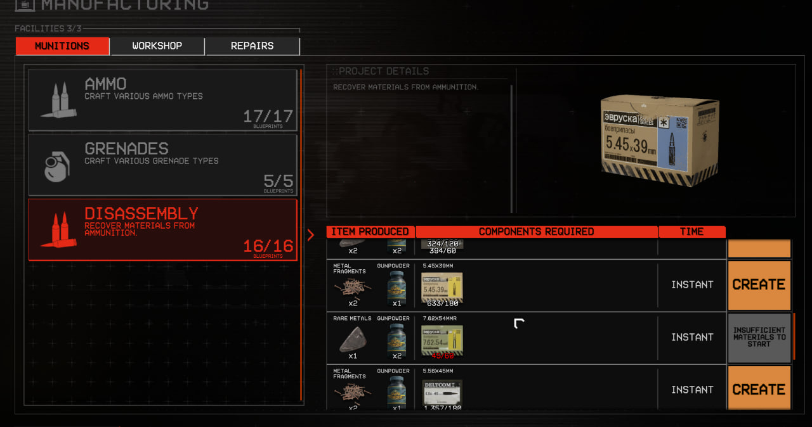
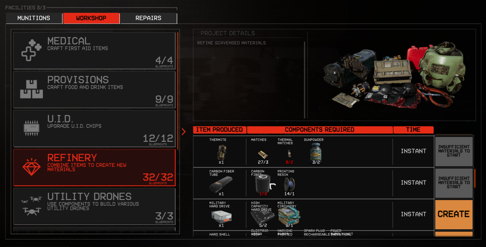
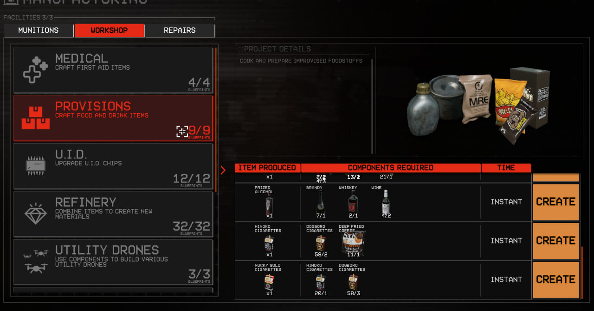

# More Crafting Recipes

This mod gives little-used loot more purpose in The Forever Winter. It adds
crafting and disassembly recipes so you can use what you already have and
spend less time farming for a specific drop. The material costs are meant to keep
crafting and scavenging useful. Disassembly has its own categories in
Manufacturing so the salvage recipes are easier to find.

## What changes in Manufacturing

- **Munitions → Disassembly** - Break down ammo into crafting materials.
- **Workshop → Disassembly** - Salvage spare equipment and supplies.
- **Workshop → U.I.D.** - Downgrade IFF chips within the same faction.
- **Workshop → Provisions** - Make alcohol and upgrade cigarettes.
- **Workshop → Refinery** - Make upgrade materials and improve tool kits.

*Workshop Disassembly shows Frequency Tap recovery and multi-output salvage.*

*Ammo salvage in the dedicated Munitions category.*

*Thermite and other supplies in the existing Workshop Refinery.*

*Alcohol recipes and both cigarette upgrades.*

The screenshots were taken with NoTimeGating enabled. Recipes inherit their stock templates’ blueprint unlock requirements.

## Requirements

**The Forever Winter for Windows (64-bit)** and **RE-UE4SS 4.0.0 Experimental**, tested with commit `b2d936b9`. UE4SS must support Lua DataTable row editing and game-thread callbacks. [UE4SS downloads](https://github.com/UE4SS-RE/RE-UE4SS/releases) · [Installation guide](https://docs.ue4ss.com/dev/installation-guide.html)

## Compatibility

- **Game updates** - The mod reads the game's live recipe tables, so it should
  keep working across updates that leave those tables and UE4SS support intact.
- **Instant crafting** - The mod works alongside **NoTimeGating** in testing.
  Other mods that only change crafting times should also be compatible. Custom
  recipes inherit the crafting times of their stock templates.

## Installation

1. Close the game and install UE4SS if needed.
2. Extract the main ZIP into `The Forever Winter\Windows\ForeverWinter\Binaries\Win64` so the included `ue4ss` folder merges with the one already there.
3. Check that the mod is under `Win64\ue4ss\Mods\MoreCraftingRecipies`. The included `enabled.txt` enables it by default.
4. Launch The Forever Winter and open Manufacturing in the Innards.

If Manufacturing still shows an old list after loading, close and reopen the inventory or Manufacturing. The mod reapplies recipes when the game's tables are recreated. See the included README for upgrade and uninstall instructions. For optional catalog tools, use the separate developer build in place of the release.

## Recipe reference

### Munitions → Disassembly

| Inputs | Outputs |
| --- | --- |
| 2 stock batches of a supported ammo recipe | 1 stock batch's original ingredients |

### Workshop → Disassembly

| Inputs | Outputs |
| --- | --- |
| 3 Signal Scrambler Grenades | 1 Frequency Tap |
| 1 Heavy-Duty Trauma Kit | 2 Bandages + 1 Medical Alcohol + 1 Tourniquet + 1 Assorted Medicine |
| 1 Sentient Drill + 1 EDC Multi-tool | 1 Wetware Processor + 1 Machine Parts |
| 1 Power Drill + 1 Screwdriver | 1 Electric Motor |
| 1 Industrial Black Light | 2 UV Light Bulbs + 2 Wires + 1 Relay |

Salvage consumes the listed tools.

### Workshop → U.I.D.

| Inputs | Outputs |
| --- | --- |
| 1 Level 3 IFF | 2 Level 2 IFFs of the same faction |
| 1 Level 2 IFF | 2 Level 1 IFFs of the same faction |

Both downgrades are available for Eurasia, Europa, and Euruska.

### Workshop → Provisions

| Inputs | Outputs |
| --- | --- |
| 2 Gin + 2 Vodka | 1 Whiskey |
| 3 Wine | 1 Brandy |
| 2 Whiskey | 1 Scotch |
| 1 Brandy + 1 Whiskey + 2 Wine | 1 Prized Alcohol |
| 2 packs of Dogboro Cigarettes + 1 Deep Fried Coffee | 1 pack of Hinoko Cigarettes |
| 1 pack of Hinoko Cigarettes + 3 packs of Dogboro Cigarettes | 1 pack of Nucky Gold Cigarettes |

### Workshop → Refinery

| Inputs | Outputs |
| --- | --- |
| 3 Matches + 2 Thermal Matches + 2 Gunpowder | 1 Thermite |
| 3 Carbon Fiber + 1 Printing Resin | 1 Carbon Fiber Tube |
| 2 High Capacity Hard Drives + 1 Military Circuitry | 1 Military Hard Drive |
| 1 High Capacity Hard Drive + 2 Printed Circuit Boards + 1 Rechargeable Battery + 1 Industrial Sealant | 1 Hard Shell Laptop |
| 1 Electric Motor + 2 Machine Parts + 2 Spark Plugs + 1 Power Supply Unit | 1 Portable Generator |
| 1 Hammer + 1 Screwdriver + 1 Basic Pliers | 1 Scavenger's Tool Kit |
| 1 Scavenger's Tool Kit + 1 Hand Drill + 1 Pipe Wrench | 1 Old Tool Set |
| 1 Old Tool Set + 1 Advanced Pliers + 1 Ratchet | 1 Intermediate Tool Set |
| 1 Intermediate Tool Set + 1 EDC Multi-tool + 1 Measuring Tape | 1 Precision Tool Set |
| 1 Diodegradable Multi-tool + 1 Battery + 1 Printed Circuit Board | 1 EDC Multi-tool |
| 2 Batteries + 1 Wires | 1 Rechargeable Battery |
| 1 Hose + 1 Duct Tape + 1 Industrial Sealant | 1 Ribbed Tube |
| 2 Metal Slats + 1 Nails | 1 Sheet Metal |
| 2 Ball Bearings + 1 Electric Motor + 1 Machine Parts | 1 Advanced Joint |
| 2 Sheet Metal + 1 Electric Motor + 1 Relay + 1 Wires | 1 Turret Component |
| 1 Clear Tube + 1 Wires | 1 Light Bulb |
| 2 individual Light Bulbs | 1 Light Bulbs pack |
| 1 Light Bulb + 1 Printed Circuit Board | 1 ES Lamp |
| 1 ES Lamp + 1 Camera Lens | 1 UV Light Bulb |
| 2 ES Lamps + 2 Sheet Metal + 1 Relay | 1 Bulkhead Lights |

The tested build placed these supplies in Refinery. Recipes that fall back to
a different stock template on another game build may appear in that template's
category. Missing templates are reported in `Win64\ue4ss\UE4SS.log`.
